# Astrix

[](https://github.com/vivek5200/astrix/actions/workflows/ci.yml)

Astrix is a local-first DevOps verification engine. It selects tests from source-level dependency impact, enforces AxLang-authored policies, optionally runs bounded LLM-assisted repair in an isolated sandbox, and exposes analysis tools over MCP.

<p align="center">
  
</p>

> Astrix is under active development. Review policies, deployment integrations, and generated changes before using them in production workflows.

## Components

- **`astrix` CLI:** validates `Astrixfile.ax`, prints symbol graphs or diff blast radiuses, verifies changes, optionally requests a bounded repair, and serves MCP tools.
- **`astrixd` daemon:** accepts HMAC-signed webhook requests and checks incoming diffs for credentials and policy violations.
- **AxLang:** the companion compiler for workspace, stage, policy, repair, and deployment declarations. The standalone compiler lives at [github.com/vivek5200/axlang](https://github.com/vivek5200/axlang).

## How the engine works

### AST blast radius

`pkg/astgraph` normalizes source definitions and references into a shared graph of symbol nodes, definition edges, and reference edges. Go files use the standard-library Go parser; JavaScript/JSX, TypeScript/TSX, and Python use Tree-sitter adapters. Other UTF-8 text files receive a conservative file-level node, so projects using other languages remain visible to `astrix graph` and changed files are not silently dropped. Add a Tree-sitter adapter to get symbol-level dependency traversal for another language. Binary assets and generated/dependency/cache directories are skipped.

```sh
astrix graph .
astrix graph . --symbol ParseConfig
astrix graph . --diff changes.patch
```

The JSON graph output includes source locations and file hashes. The `--diff` form emits changed symbols, the transitive impact set, and selected tests. For languages without an AST adapter, blast radius is file-level and cannot infer callers or select language-specific tests reliably.

### Cache and flaky-test history

`pkg/cache` derives stable SHA-256 keys from symbol subgraphs and edges and stores verification outcomes beneath `.astrix/cache`. `pkg/runner` tracks bounded per-test outcome history in SQLite and computes a rolling failure fraction for quarantine decisions. The cache is local to the repository unless an external cache layer is added by the caller.

### Policy gate

`Astrixfile.ax` policies compile through AxLang to Rego v1 and are evaluated by the embedded OPA engine against an `ActionIntent`. Guardrails can deny an action or require approval. Diff glob rules operate on the modified-file list; secret scanning runs at ingress and blocks findings before policy evaluation.

### Bounded repair triage

`astrix verify --fix` runs verification, sanitizes nondeterministic log details, constructs a repair prompt with impact context, and requests a unified diff from an OpenAI-compatible endpoint. The patcher bounds attempts to three, rejects forbidden test changes, applies policy before acceptance, and verifies candidate changes in a disposable Docker sandbox with networking disabled. Keep credentials in environment variables or a local ignored `.env` file.

`astrix verify` detects common project test runners (Go, npm, pytest, Cargo, Maven/Gradle, .NET, Composer, Bundler, and Make). For another build system or a monorepo with a nonstandard command, set `ASTRIX_TEST_COMMAND` to a JSON argument array, such as `ASTRIX_TEST_COMMAND='["./scripts/check.sh","--ci"]' astrix verify`. This runs the command directly without a shell. For `astrix verify --fix`, set `ASTRIX_SANDBOX_IMAGE` to an image with the required toolchain; the repair sandbox has no network access and mounts existing `node_modules` and `vendor` trees read-only. Other offline dependencies must be available through the selected image or project setup. Common-language AST support and test-command detection are separate capabilities: unknown languages still receive file-level graph coverage, while test execution uses the project's detected or configured command.

### MCP server

`astrix mcp serve` runs JSON-RPC over stdio and exposes `astrix_get_blast_radius`, `astrix_evaluate_policy`, and `astrix_run_impacted_tests` so compatible clients can inspect impact, evaluate an intent, and run selected tests.

### Canary watcher

`pkg/canary` maps a validated AxLang deploy declaration to progressive traffic steps, polling intervals, and SLO thresholds. It provides Prometheus query and HTTP traffic-controller adapters. On a breached SLO, the watcher requests rollback through the configured controller. Integrators supply endpoints and deployment credentials.

## Requirements and install

- Go 1.26 or newer for this module.
- Docker for isolated repair verification.
- An OpenAI-compatible model endpoint for LLM-assisted repair.

```sh
go install github.com/vivek5200/astrix/cmd/astrix@latest
go install github.com/vivek5200/astrix/cmd/astrixd@latest
```

Install `axc` and `axls` from the companion AxLang project.

## Configure

Create a local `.env` in the repository root for model-assisted repair:

```dotenv
ASTRIX_LLM_BASE_URL=http://localhost:8000/v1
ASTRIX_LLM_API_KEY=replace-with-your-local-key
ASTRIX_LLM_MODEL=your-model-name
```

`ASTRIX_LLM_ENDPOINT` can provide a full chat-completions URL. Process environment settings take precedence over `.env`. Never commit real credentials.

The daemon accepts `ASTRIX_WEBHOOK_SECRET` and `ASTRIXD_ADDR`; it serves `/healthz` and an HMAC-SHA256 authenticated `/webhook`. It does not terminate TLS, so deploy it behind a TLS-terminating reverse proxy on a trusted network.

## CLI reference

```sh
astrix check [Astrixfile.ax]
astrix graph [path] [--symbol name]
astrix graph [path] --diff changes.patch
astrix verify
astrix verify --fix
astrix mcp serve
```

## Development

```sh
go test -race ./...
go vet ./...
go build ./cmd/astrix ./cmd/astrixd
```

The live Docker/LLM scenario is skipped if its endpoint credentials or Docker daemon are unavailable. It can be run explicitly with:

```sh
go test -v ./e2e -run '^TestLiveDockerAndLLM_ClosedLoopSelfHealing$' -count=1
```

Set `ASTRIX_RUN_LIVE_E2E=1` to opt into that test; ordinary `go test ./...` runs the deterministic suite and skips external LLM calls.

The dual-repository workspace includes a self-hosted validation workflow and a root `Makefile`; see the workspace overview for commands.

See [ARCHITECTURE.md](ARCHITECTURE.md) for graph, policy, repair, and runtime subsystem details.

## License

Apache License 2.0. See [LICENSE](LICENSE).
